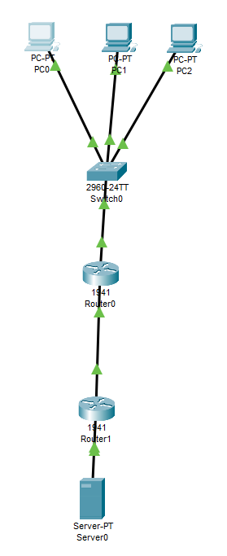

# Урок 13. DNS: иерархия имен, зоны и процесс разрешения

**Выполнил:** Абдуллаев Билол, группа РПО 3

## Цель работы
Изучить принципы работы DNS: иерархию доменных имён, понятие зон
и процесс разрешения имён.

## Теория

### Иерархия имён DNS
- Корневая зона (`.`)
- TLD: `.com`, `.org`, `.ru`, `.net`
- Домены второго уровня: `example.com`
- Поддомены: `www.example.com`

FQDN читается справа налево: `www.example.com.`

### Типы записей

| Тип | Назначение |
|-----|------------|
| A     | IPv4-адрес |
| AAAA  | IPv6-адрес |
| CNAME | Псевдоним |
| MX    | Почтовый сервер |
| NS    | DNS-сервер зоны |
| PTR   | Обратное разрешение |

### Процесс разрешения
1. Локальный кэш / hosts
2. Рекурсивный DNS-сервер
3. Корневые серверы
4. Сервер зоны TLD
5. Авторитетный сервер домена
6. Возврат A-записи и кэширование

## Практика (Cisco Packet Tracer)

Топология: 3 ПК → коммутатор 2960-24TT → Router0 (1841) → Router1 (1841) → Server0 (DNS).

### Настройка DNS на Server0