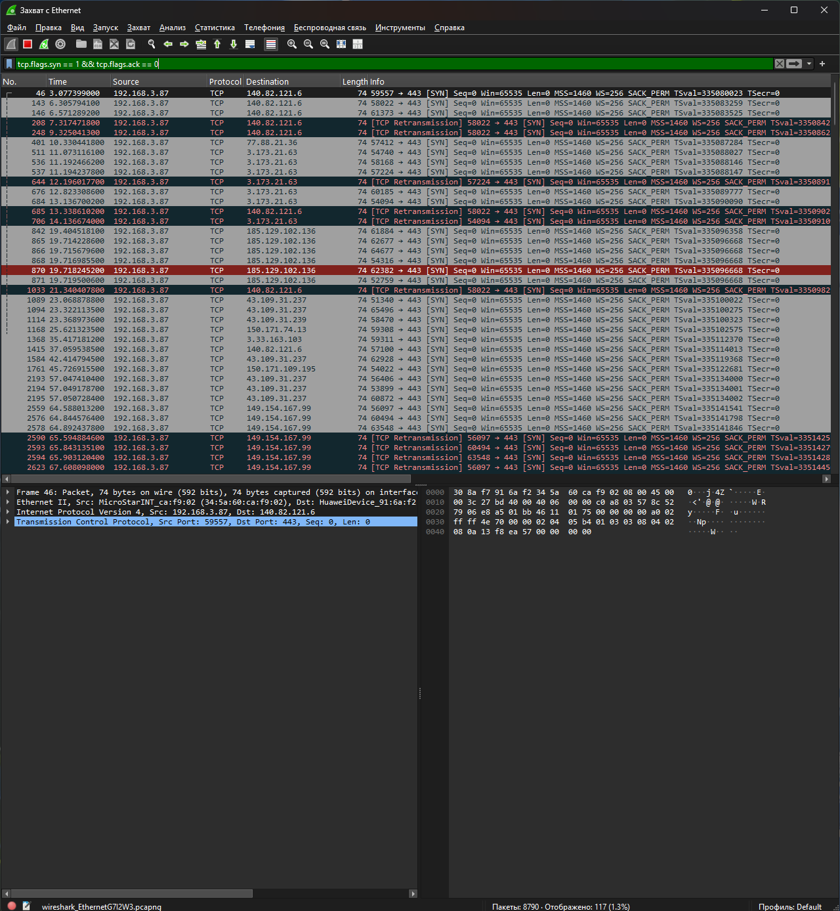
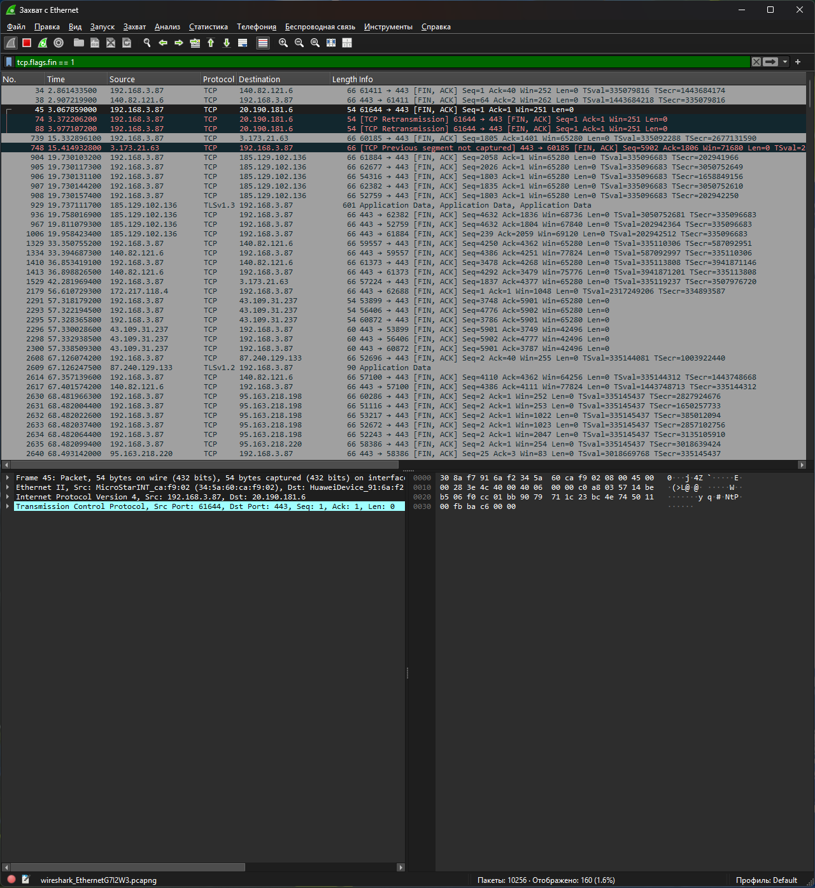
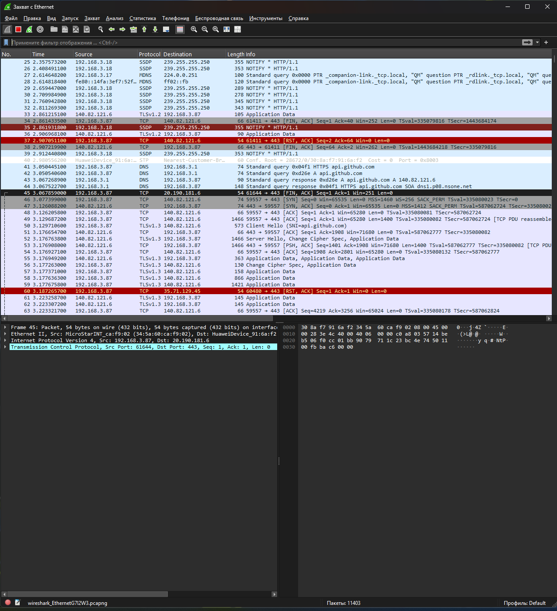

# Порты, сетевые сокеты и состояние соединений

Домашнее задание по теме «Порты, сетевые сокеты и состояние соединений».

## 📌 Теоретическая часть

**Порт** — числовой идентификатор (0–65535), указывающий, какому приложению
предназначены данные.

**Сокет** — комбинация IP-адреса и порта, например `192.168.3.87:443`.

### Диапазоны портов

| Диапазон    | Название          | Примеры                                    |
|-------------|-------------------|--------------------------------------------|
| 0–1023      | Well-known        | 80 (HTTP), 443 (HTTPS), 22 (SSH), 53 (DNS) |
| 1024–49151  | Registered        | 3306 (MySQL), 8080                         |
| 49152–65535 | Dynamic / Private | временные порты клиентов                   |

### Состояния TCP-соединения

| Состояние    | Описание                          |
|--------------|-----------------------------------|
| LISTEN       | Сокет ожидает входящее соединение |
| SYN-SENT     | Отправлен SYN, ожидается SYN+ACK  |
| SYN-RECEIVED | Получен SYN, отправлен SYN+ACK    |
| ESTABLISHED  | Соединение установлено            |
| FIN-WAIT-1/2 | Инициировано закрытие             |
| CLOSE-WAIT   | Получен FIN от собеседника        |
| TIME-WAIT    | Ожидание перед закрытием (2MSL)   |
| CLOSED       | Соединение закрыто                |

### Флаги TCP

`SYN` — запрос соединения · `ACK` — подтверждение · `FIN` — закрытие ·
`RST` — сброс · `PSH` — передача данных · `URG` — срочные данные

## 🖼 Практическая часть (Wireshark)

### 1. TCP с флагом SYN
Фильтр: `tcp.flags.syn == 1 && tcp.flags.ack == 0`



### 2. TCP с флагом FIN
Фильтр: `tcp.flags.fin == 1`



### 3. UDP-пакет
Фильтр: `udp`



## 💻 Практика в терминале

### Linux / macOS
```bash
ss -tunap
ss -tlnp
```

### Windows (PowerShell)
```powershell
netstat -ano
Get-NetTCPConnection | Where-Object State -eq "Listen"
```